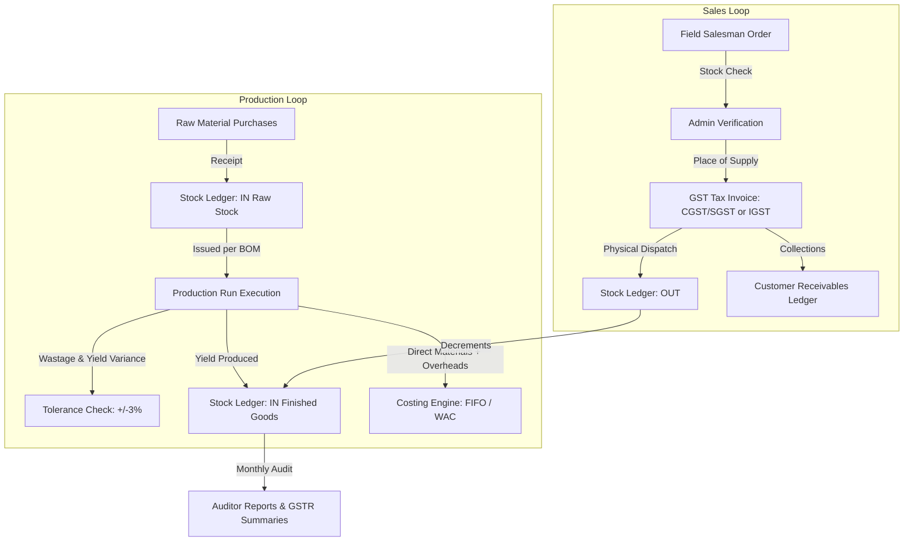
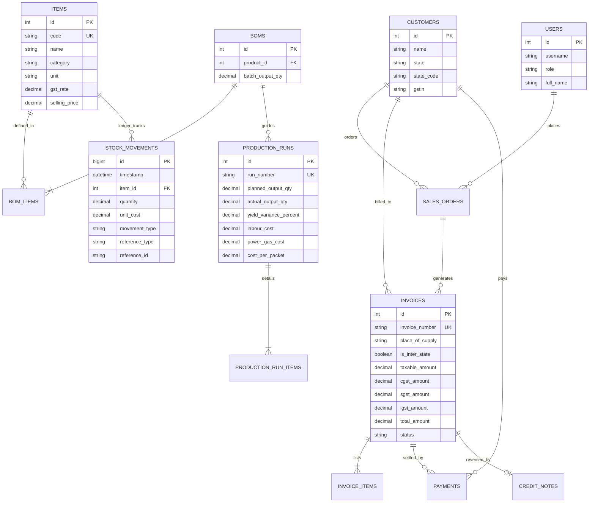

# Design Note: Order-to-Audit System for Small Food Manufacturer
**Applicant Shortlisting Submission | Centre for Digital Infrastructure, NIT Tiruchirappalli**

> 📺 **Demo Video Walkthrough (Section 5 Benchmark):** [https://youtu.be/-Rm7o3grKjA](https://youtu.be/-Rm7o3grKjA)

---

## 1. System Architecture & Dual-Loop Core

A small food manufacturing business operates through two interconnected physical loops that converge at **Finished Goods Inventory**:

---

## 2. Relational Data Model & ER Diagram

The system guarantees that **stock balances are derived exclusively by summing an immutable ledger of movements (`stock_movements`)**, preventing stock drift or arbitrary manual overwrites.

---

## 3. Stock Movement & BOM Computation Engine

### A. Immutable Ledger Valuation
Stock at any moment in time $T$ is computed deterministically:
$$\text{Stock Balance}_i(T) = \sum_{m \in \text{Movements}_i, t \le T} m.\text{quantity}$$

Movement categories enforce strict debit/credit behavior:
* **Inflows ($+$):** `OPENING_BALANCE`, `PURCHASE_RECEIPT`, `PRODUCTION_YIELD`, `SALES_RETURN`
* **Outflows ($-$) :** `PRODUCTION_ISSUE`, `SCRAP_DAMAGE`, `SALES_DISPATCH`

### B. BOM Recipe & Variance Detection
For a standard batch size of 200 packets of *Murukku 200g*:
* Standard Inputs: Flour (40 kg), Oil (10 L), Spice mix (1.2 kg), Pouches (200 pcs), Cartons (10 pcs).

When a production run is recorded:
1. **Yield Variance:**
   $$\text{Yield Variance \%} = \frac{\text{Actual Output} - \text{Expected Output}}{\text{Expected Output}} \times 100$$
   $$\frac{188 - 200}{200} \times 100 = \mathbf{-6.00\%} \quad (\text{Flagged: } |-6.00\%| > 3.0\%)$$

2. **Consumption Variance:**
   $$\text{Consumption Variance \%} = \frac{\text{Actual Quantity Used} - \text{Standard Quantity}}{\text{Standard Quantity}} \times 100$$
   $$\text{Oil Variance: } \frac{10.5 - 10.0}{10.0} \times 100 = \mathbf{+5.00\%} \quad (\text{Flagged: } |+5.00\%| > 3.0\%)$$

---

## 4. Costing & Valuation Methodology

The system uses **Periodic Moving Weighted Average Costing (WAC)** for raw materials and packaging:

$$\bar{C}_{\text{item}} = \frac{\sum (\text{Qty}_{\text{inflow}} \times \text{Rate}_{\text{inflow}})}{\sum \text{Qty}_{\text{inflow}}}$$

### Section 5 Batch Cost Breakdown
* **Flour:** Opening 100 kg @ ₹42 (₹4,200) + Purchase 60 kg @ ₹45 (₹2,700).  
  Average Rate = $\frac{₹6,900}{160\text{ kg}} = \mathbf{₹43.125/\text{kg}}$.  
  40 kg issued = $40 \times ₹43.125 = \mathbf{₹1,725.00}$.
* **Cooking Oil:** 10.5 L @ ₹140 = **₹1,470.00**.
* **Salt & Spice Mix:** 1.2 kg @ ₹200 = **₹240.00**.
* **Pouches:** $(188 \text{ used} + 6 \text{ damaged}) \times ₹2.50 = 194 \times ₹2.50 = \mathbf{₹485.00}$.
* **Cartons:** 9 pcs used @ ₹15 = **₹135.00**.
* **Total Direct Material Cost:** $1725 + 1470 + 240 + 485 + 135 = \mathbf{₹4,055.00}$.

### Overhead Allocation & Unit Cost
* Overheads: Labour (₹1,200) + Power/Gas (₹600) = **₹1,800.00**.
* Total Batch Production Cost = $₹4,055 + ₹1,800 = \mathbf{₹5,855.00}$.
* **Unit Cost per Packet:**
  $$\text{Cost per Packet} = \frac{\text{Total Production Cost}}{\text{Actual Output Packets}} = \frac{₹5,855.00}{188} = \mathbf{₹31.14 \text{ per packet}}$$
* **Gross Profit Margin** against ₹50 selling price:
  $$\text{Margin \%} = \frac{50.00 - 31.14}{50.00} \times 100 = \mathbf{37.72\%}$$

---

## 5. GST Engine Rules (Inter vs Intra-State)

The factory is registered in **Tamil Nadu (State Code: 33)**:
* **Intra-State Supply (Retailer A - Tamil Nadu):**
  * Taxable Amount: $150 \times ₹50 = \mathbf{₹7,500.00}$.
  * CGST @ 2.5% = **₹187.50**; SGST @ 2.5% = **₹187.50**. Total Invoice = **₹7,875.00**.
* **Inter-State Supply (Distributor B - Karnataka):**
  * Place of supply $\ne$ Factory state.
  * IGST @ 5.0% applies.

---

## 6. Audit Trail & Immutability Rules

1. **Zero Overwrite Principle:** Stock movements table only accepts `INSERT` operations. `UPDATE` and `DELETE` queries are prohibited.
2. **Credit Note Reversals:** Invoices cannot be deleted. Cancelling an invoice creates an immutable `credit_notes` entry and inserts positive reversal movements into `stock_movements`.
3. **Decimal Precision:** All currency and quantity fields utilize `Numeric(12, 4)` and Python's `decimal.Decimal` to avoid IEEE-754 floating point drift.
